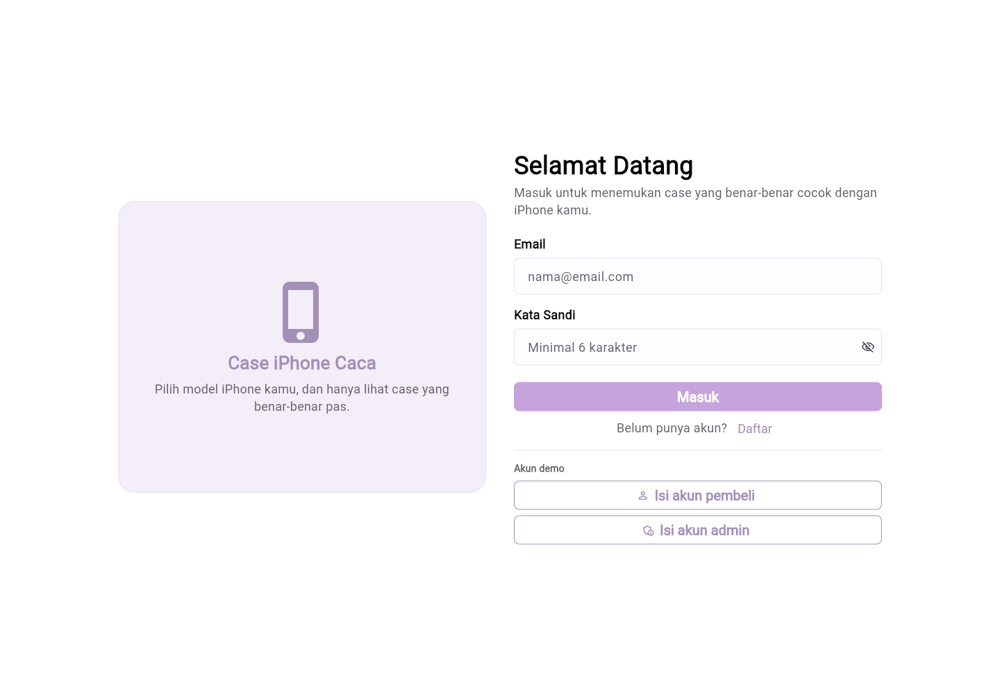
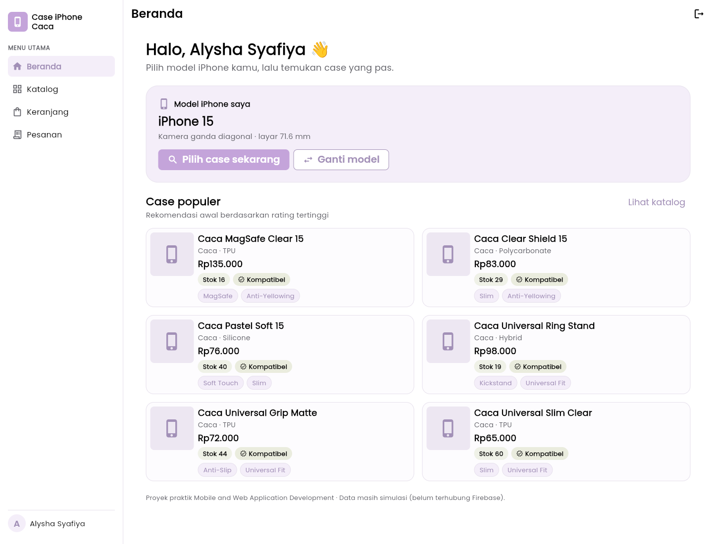
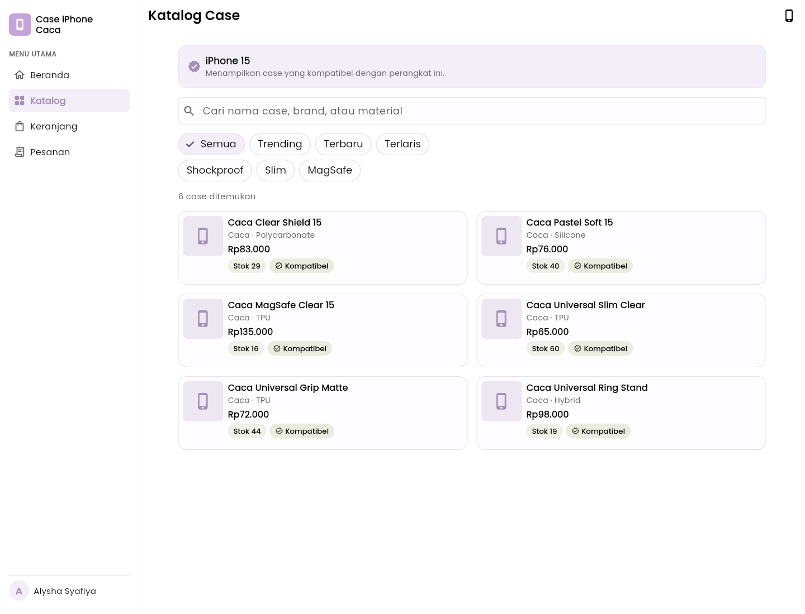
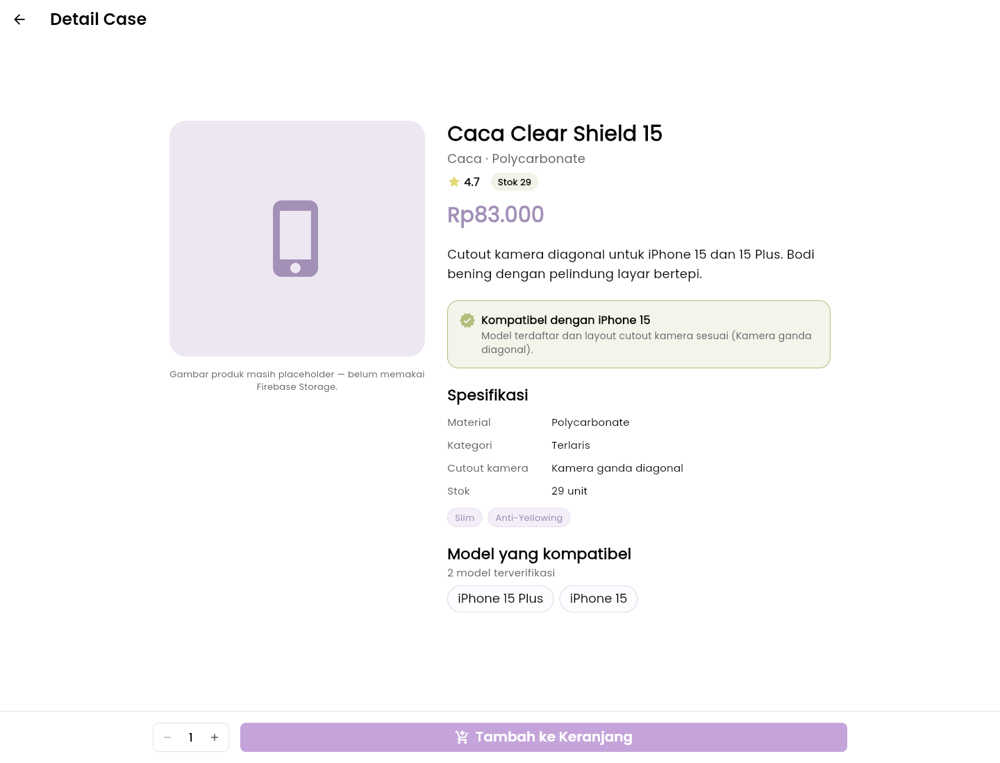
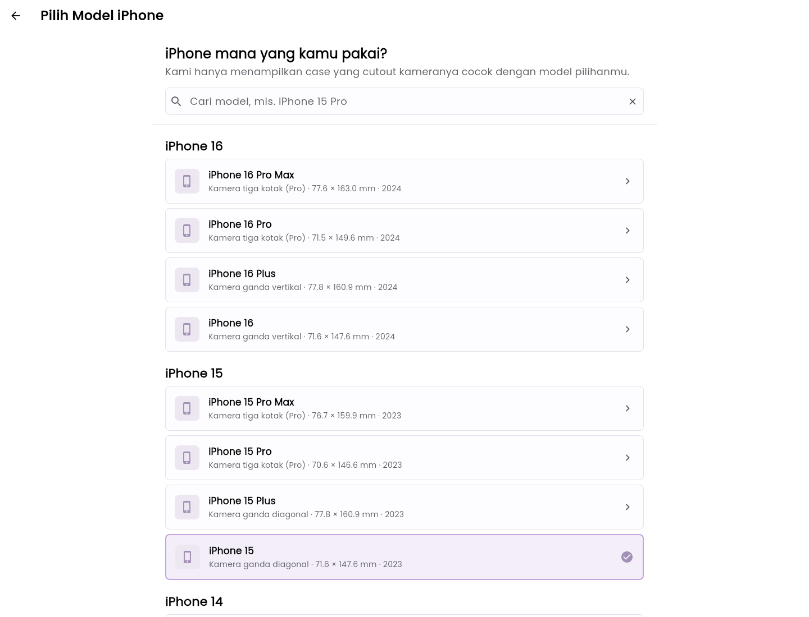
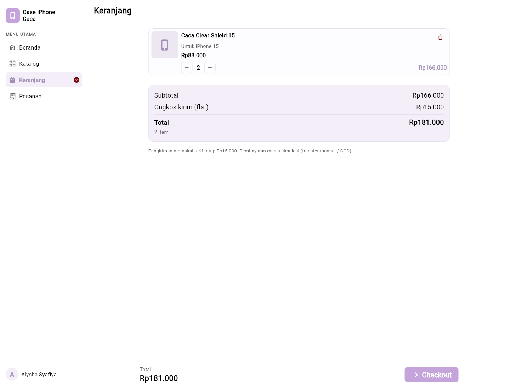
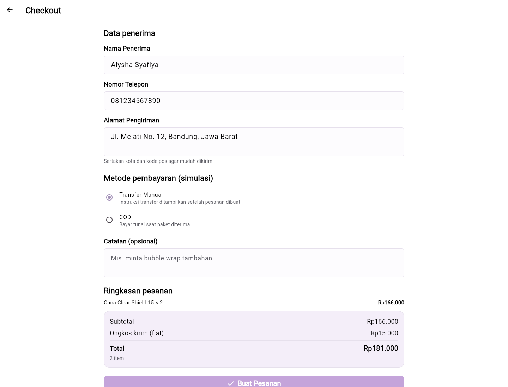
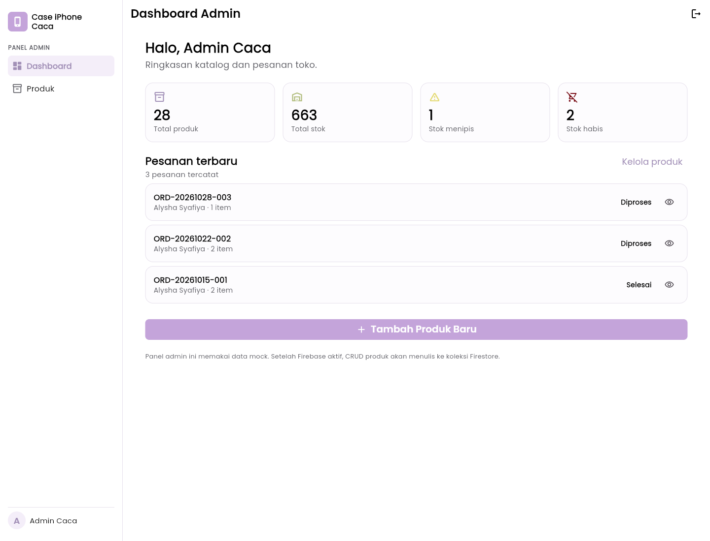
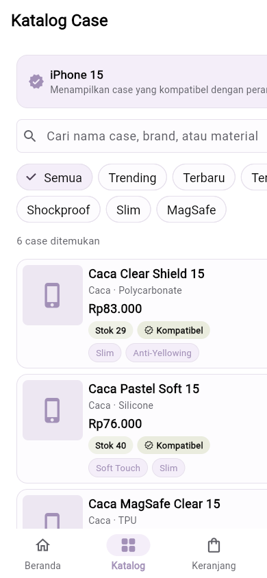
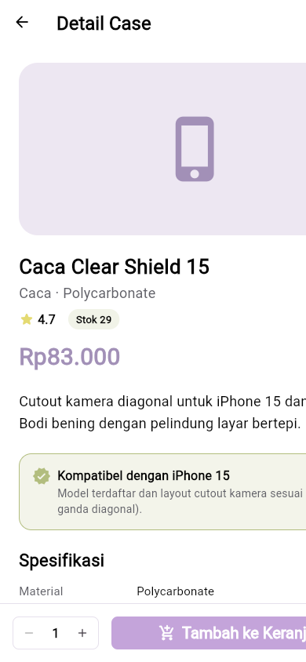

# CASE IPHONE CACA

**Aplikasi Katalog dan Pemilihan Case iPhone Berdasarkan Model iPhone**

> Repositori ini berisi **source code lengkap Flutter/Dart** (mobile **dan** web), proposal UTS, diagram perancangan, dan screenshot — bukan hanya README dan screenshot. Seluruh kode aplikasi ada di folder `lib/` dan dapat langsung dijalankan dengan `flutter run` atau `flutter run -d chrome`.

- Repository: https://github.com/cacaalycha/UTS-MOBILE-AND-WEB-APPLICATION-DEVELOPMENT
- Demo web (GitHub Pages): https://cacaalycha.github.io/UTS-MOBILE-AND-WEB-APPLICATION-DEVELOPMENT/

> **Pembaruan Minggu 9:** repositori ini sekarang juga memuat alur login **Firebase Authentication** (Email/Password, target Chrome, paket Spark). Lihat [bagian 13](#13-praktikum-minggu-9--firebase-authentication) serta [`docs/LAPORAN_MINGGU_09.md`](docs/LAPORAN_MINGGU_09.md).
>
> **Pembaruan Minggu 10:** data katalog dan pesanan kini tersimpan permanen di **Cloud Firestore** (tiga collection `users`, `cases`, `orders`) dan tampil real-time lewat `StreamBuilder`. Lihat [bagian 14](#14-praktikum-minggu-10--cloud-firestore), [`docs/PANDUAN_FIRESTORE_MINGGU_10.md`](docs/PANDUAN_FIRESTORE_MINGGU_10.md), dan [`docs/LAPORAN_MINGGU_10.md`](docs/LAPORAN_MINGGU_10.md).
>
> **Pembaruan Minggu 11:** siklus CRUD lengkap — pesanan bisa **diubah** dan **dihapus** oleh pemiliknya selama masih berstatus Menunggu, dengan dialog konfirmasi dan Security Rules kepemilikan. Lihat [bagian 15](#15-praktikum-minggu-11--crud-edit-hapus), [`docs/PANDUAN_CRUD_MINGGU_11.md`](docs/PANDUAN_CRUD_MINGGU_11.md), dan [`docs/LAPORAN_MINGGU_11.md`](docs/LAPORAN_MINGGU_11.md).

---

## 1. Identitas Project

| Keterangan | Informasi |
|---|---|
| Nama Project | Case iPhone Caca |
| Nama Mahasiswa | Alysha Syafiya Maisaroh |
| NIM | 23.01.55.0001 |
| Kelas | Pagi A1 |
| Mata Kuliah | Mobile and Web Application Development |
| Framework | Flutter (Dart) |
| Package name | `case_iphone_caca` |
| Versi | 1.0.0+1 |

## 2. Deskripsi Project

Case iPhone Caca merupakan aplikasi katalog penjualan case iPhone berbasis Flutter yang membantu pengguna menemukan case yang benar-benar cocok dengan model iPhone yang dimiliki. Permasalahan utama yang diselesaikan adalah **ketidakcocokan case dengan model iPhone** (terutama perbedaan cutout kamera dan ukuran bodi) yang sering menyebabkan salah beli.

Aplikasi menyediakan pemilihan model iPhone, katalog produk, detail produk, **Compatibility Checker** yang menyaring case berdasarkan model dan tipe cutout kamera, keranjang belanja, checkout dengan validasi form, riwayat pesanan, serta halaman admin untuk kelola produk. Pengguna utamanya adalah pemilik iPhone yang ingin membeli case secara online, dan admin toko sebagai pengelola katalog.

Prototipe UTS memakai **mock data / mock repository** (tanpa backend). Mulai Minggu 9 **autentikasi** terhubung ke Firebase Authentication, dan mulai Minggu 10 **profil pengguna, master case, dan pesanan** tersimpan permanen di Cloud Firestore dalam tiga collection `users`, `cases`, `orders` (operasi Create + Read, real-time). Kedua mode tetap berdampingan: tanpa konfigurasi `FIREBASE_*` aplikasi berjalan sebagai prototipe mock agar pengujian dan demo GitHub Pages tidak bergantung pada cloud. Rancangan database Firestore lengkap ada di proposal dan `docs/firestore-schema.png`.

## 3. Isi Repositori (Source Code Lengkap)

| Folder / Berkas | Isi |
|---|---|
| `lib/main.dart`, `lib/main_uts.dart` | Entry point mode Firebase (Minggu 9) dan mode prototipe UTS untuk build web |
| `lib/app.dart`, `lib/firebase_login_app.dart` | Root widget prototipe UTS (Provider) dan root widget praktikum Minggu 9 |
| `lib/models/` | 5 model: `UserModel`, `IphoneModel`, `CaseModel`, `CartItemModel`, `OrderModel` |
| `lib/data/mock/` | Data mock: 20 model iPhone, case, pesanan, akun demo |
| `lib/data/repositories/` | Abstraksi repository + 4 implementasi mock (auth, product, cart, order) |
| `lib/providers/` | State management `ChangeNotifier`: auth, product, cart, order |
| `lib/router/app_router.dart` | GoRouter + `StatefulShellRoute` + role guard (pembeli/admin) |
| `lib/pages/auth/` | Login & Register prototipe UTS dengan validasi form |
| `lib/pages/home/`, `lib/pages/model/` | Beranda & Pemilihan Model iPhone |
| `lib/pages/catalog/` | Katalog (filter + pencarian) & Detail Case + Compatibility Checker |
| `lib/pages/cart/`, `lib/pages/order/` | Keranjang, Checkout, Konfirmasi, Pesanan Saya, Detail Pesanan |
| `lib/pages/admin/` | Dashboard Admin, Kelola Produk, Form Tambah/Edit Produk |
| `lib/widgets/` | Widget reusable: `AppShell`, `CaseCard`, buttons, badges, empty state, section header |
| `lib/core/` | Tema Material 3, warna, tipografi, spacing, validator |
| `lib/firebase_options.dart`, `firebase-config.example.json` | Konfigurasi project Firebase via `--dart-define` (tanpa menyimpan nilai di Git) |
| `lib/utils/validasi_auth.dart` | Validator + terjemahan 7 kode `FirebaseAuthException` (Minggu 9) |
| `lib/pages/masuk_page.dart`, `lib/pages/cek_status_login.dart`, `lib/pages/halaman_utama.dart` | Halaman Masuk/Daftar dua mode, gerbang `authStateChanges()`, halaman utama + tombol Keluar |
| `lib/data/data_simulasi.dart` | Model dokumen Firestore Minggu 10: `PenggunaFirestore`, `CaseKatalog`, `PesananFirestore` + 4 case auto-seed |
| `lib/services/` | `LayananData` (kontrak), `LayananFirestore`, `LayananMemori` (untuk test), `FirestoreStatus` |
| `lib/pages/minggu10/` | Beranda Firestore, Daftar Case, Form Pesanan, Pesanan Saya |
| `lib/widgets/components/sapaan_firestore.dart` | Sapaan real-time dari `users/{uid}` |
| `lib/firebase_katalog_app.dart` | Root mode Firebase: menyuntik `Provider<LayananData>`, membuat profil & auto-seed `cases` |
| `firestore.rules` | Aturan keamanan: login required + kepemilikan `orders` + status `Menunggu` (Minggu 11) |
| `test/` | 14 file widget/unit test, **107 test** (Minggu 9, Minggu 10, dan aturan/layanan/UI Minggu 11) |
| `android/`, `ios/`, `web/`, `windows/`, `linux/`, `macos/` | Konfigurasi platform bawaan Flutter (termasuk **Flutter Web**) |
| `pubspec.yaml`, `pubspec.lock`, `analysis_options.yaml`, `.metadata` | Dependensi dan konfigurasi project |
| `Proyek_UTS_Case_iPhone_Caca_Proposal.docx` / `.pdf` | Proposal UTS lengkap |
| `docs/` | Diagram user flow, sitemap, wireframe, skema Firestore, panduan & laporan praktikum Minggu 9 dan Minggu 10 |
| `screenshots/` | 10 screenshot aplikasi UTS + screenshot Firebase Console Minggu 9 & Minggu 10 |
| branch `gh-pages` | Hasil build statis `flutter build web --release` (versi web siap hosting) |

## 4. Fitur Aplikasi

### A. Fitur Pembeli
- **Login & Register** — autentikasi mock dengan validasi email dan password.
- **Beranda** — ringkasan produk dan akses cepat ke fitur utama.
- **Pilih Model iPhone** — 20 model dikelompokkan per seri; model tersimpan sebagai preferensi.
- **Katalog Produk** — daftar case dengan pencarian dan filter kategori.
- **Compatibility Checker** — case hanya tampil bila model iPhone terdaftar dan tipe cutout kamera cocok.
- **Detail Produk** — informasi case, harga, daftar model kompatibel.
- **Keranjang Belanja** — tambah/hapus item, ubah jumlah, total harga.
- **Checkout** — form nama, telepon, alamat dengan validasi (wajib diisi, format, minimal panjang).
- **Konfirmasi & Pesanan Saya** — status pesanan beserta detail.

### B. Fitur Admin
- Dashboard admin, manajemen produk (tambah, edit, hapus) dengan form tervalidasi.

### C. Fitur Minggu 9 (Firebase)
- Daftar, masuk, dan keluar dengan Firebase Authentication (Email/Password).
- Halaman utama hanya terbuka setelah login; sesi bertahan setelah refresh browser.
- Pesan kesalahan yang jelas dari 7 kode `FirebaseAuthException`.

### D. Fitur Minggu 10 (Cloud Firestore)
- **Profil otomatis** — `users/{uid}` dibuat saat daftar/masuk; sapaan nama real-time di Beranda.
- **Master case** — collection `cases` diisi otomatis 4 dokumen lewat `WriteBatch`, tampil di Daftar Case dan dropdown Form Pesanan.
- **Form Pesanan (Create)** — validasi jumlah, tanggal, jam; menyimpan dokumen `orders` beserta `nama_case` (denormalisasi) dan `FieldValue.serverTimestamp()`.
- **Cegah bentrok** — kombinasi `id_pengguna + id_case + tanggal + jam` yang sama ditolak dengan SnackBar, dokumen tidak bertambah.
- **Pesanan Saya (Read)** — `StreamBuilder` + `.snapshots()` terfilter per `uid`, menangani keadaan loading / error / kosong, dan bertahan setelah refresh Chrome.
- **Security Rules** — hanya pengguna terautentikasi yang boleh membaca/menulis.

### E. Fitur Minggu 11 (CRUD lengkap)
- **Ubah pesanan** — menu Ubah membuka form yang sama dalam mode ubah; isian terisi data lama dan tombol menjadi **Simpan Perubahan**.
- **Field audit aman** — memakai `doc.update()`, bukan `set()`; `dibuat_pada`, `id_pengguna`, dan `status` tidak berubah, `diubah_pada` ditambahkan.
- **Bentrok saat ubah** — kombinasi case+tanggal+jam dicek ulang, tetapi dokumen yang sedang diubah dikecualikan (`abaikanId`).
- **Hapus dengan konfirmasi** — `showDialog<bool>` menyebut case, tanggal, dan jam; **Batal** tidak mengubah data; **Hapus** memanggil `delete()` dan memunculkan SnackBar.
- **Rules kepemilikan** — ubah/hapus hanya untuk `id_pengguna == uid` dan status `Menunggu`; menu dinonaktifkan bila status terkunci.

### F. Prioritas Fitur
Urutan prioritas: (1) pemilihan model iPhone, (2) Compatibility Checker, (3) katalog & detail, (4) keranjang + checkout tervalidasi, (5) riwayat pesanan, (6) admin. Alur inti "pilih model → cari case yang cocok → pesan" diprioritaskan karena itulah yang langsung menyelesaikan masalah salah beli case.

## 5. Desain UI/UX dan Prototype Figma

- **Figma Design / Wireframe:** https://www.figma.com/design/TPBZUe0azGKFVuAyHcQ0nq/-23.01.55.0001--%E2%80%93--Case-iPhone-Caca--%E2%80%93-Wireframe?node-id=1-2&t=lGxr09H65HQXbOiX-1
- **Figma Prototype:** https://www.figma.com/proto/TPBZUe0azGKFVuAyHcQ0nq/-23.01.55.0001--%E2%80%93--Case-iPhone-Caca--%E2%80%93-Wireframe?node-id=7-22&p=f&t=3IUcGORs9VA7dQZJ-1&scaling=scale-down&content-scaling=fixed&page-id=1%3A3&starting-point-node-id=7%3A22
- Versi gambar lokal (tanpa perlu login Figma): `docs/wireframe.png`

Diagram perancangan lainnya:

| Diagram | Berkas |
|---|---|
| User flow | `docs/user-flow.png` |
| Sitemap | `docs/sitemap.png` |
| Wireframe low fidelity | `docs/wireframe.png` |
| Rancangan database Firestore | `docs/firestore-schema.png` |

## 6. Proposal UTS

- **PDF:** [`Proyek_UTS_Case_iPhone_Caca_Proposal.pdf`](Proyek_UTS_Case_iPhone_Caca_Proposal.pdf)
- **DOCX:** [`Proyek_UTS_Case_iPhone_Caca_Proposal.docx`](Proyek_UTS_Case_iPhone_Caca_Proposal.docx)

Berisi: problem statement, persona, user story, kebutuhan fungsional & non-fungsional, prioritas fitur, user flow, sitemap, wireframe, tech stack, rancangan database Firestore, rencana pengujian, dan roadmap pengembangan.

## 7. Teknologi yang Digunakan

| Teknologi | Kegunaan |
|---|---|
| Flutter 3.x / Dart 3 | Framework & bahasa (Material 3, responsif mobile & web) |
| Provider | State management (`ChangeNotifier`) |
| GoRouter | Navigasi, nested shell route, redirect & role guard |
| Google Fonts | Tipografi |
| Intl | Format mata uang / angka |
| Cupertino Icons | Ikon antarmuka |
| Flutter Web | Target web (`flutter run -d chrome`, `flutter build web`) |
| Figma | Perancangan UI/UX dan prototype |
| GitHub / GitHub Pages | Source code, riwayat commit, dan hosting demo web |
| Firebase Authentication (`firebase_core` 5.1.0, `firebase_auth` 7.0.1) | Praktikum Minggu 9: daftar, masuk, keluar, cek status login (Email/Password, target Chrome) |
| Cloud Firestore (`cloud_firestore` 7.1.0) | Minggu 10: `users`, `cases`, `orders` — `WriteBatch`, `FieldValue.serverTimestamp()`, `.snapshots()` + `StreamBuilder` |
| Firestore CRUD + Security Rules | Minggu 11: `update()`/`delete()`, cek bentrok dengan `abaikanId`, dialog konfirmasi, Rules kepemilikan & status Menunggu |

## 8. Cara Menjalankan Project

### Persyaratan
- Flutter SDK (Dart SDK termasuk di dalamnya)
- VS Code / Android Studio
- Emulator Android, perangkat fisik, atau Chrome untuk target web

### Langkah 1 — Clone / buka folder project

```bash
git clone https://github.com/cacaalycha/UTS-MOBILE-AND-WEB-APPLICATION-DEVELOPMENT.git
cd UTS-MOBILE-AND-WEB-APPLICATION-DEVELOPMENT
```

### Langkah 2 — Install dependencies

```bash
flutter pub get
```

### Langkah 3 — Cek konfigurasi (opsional)

```bash
flutter doctor
flutter analyze
```

### Langkah 4 — Jalankan aplikasi

```bash
# Mobile / desktop (pilih device yang tersedia) — mode prototipe UTS
flutter run

# Web di Chrome — mode prototipe UTS (mock, tanpa Firebase)
flutter run -d chrome

# Web di Chrome — praktikum Minggu 9 + Minggu 10 (mode Firebase + Firestore)
flutter run -d chrome --dart-define-from-file=firebase-config.json

# Build release mode Firebase (hasil di build/web)
MSYS_NO_PATHCONV=1 flutter build web --release \
  --dart-define-from-file=firebase-config.json

# Atau build web statis mode prototipe UTS lalu sajikan folder build/web
flutter build web --release
```

> **Minggu 10 — setup Console (sudah selesai 22 November 2026):** database
> Firestore `(default)` aktif pada paket Spark dan aturan `request.auth != null`
> sudah dipublikasikan. Untuk project baru: **Databases & Storage → Firestore
> Database → Create database** (Standard / Spark, `asia-southeast2` Jakarta),
> lalu publish aturan dari `firestore.rules`. Bila database belum aktif,
> aplikasi tetap terbuka tetapi Beranda Firestore menampilkan banner peringatan.
> Rincian ada di [`docs/PANDUAN_FIRESTORE_MINGGU_10.md`](docs/PANDUAN_FIRESTORE_MINGGU_10.md)
> dan [`docs/langkah-aktifkan-firestore.png`](docs/langkah-aktifkan-firestore.png).

Aplikasi memiliki **dua mode** yang dipilih otomatis di `lib/main.dart`: bila
lima nilai `FIREBASE_*` diberikan, `Firebase.initializeApp()` dijalankan dan
yang tampil adalah alur login Minggu 9; bila tidak, yang tampil adalah prototipe
UTS berbasis mock. Cara mengisi konfigurasi dijelaskan di
[`docs/PANDUAN_FIREBASE_MINGGU_09.md`](docs/PANDUAN_FIREBASE_MINGGU_09.md).

> **Peran admin pada mode Firebase.** Firebase Authentication hanya menyimpan
> uid, email, dan password — **tidak ada field role**. Karena Minggu 9/10 belum
> membahas Custom Claims / Admin SDK, peran ditentukan dari daftar email pada
> konfigurasi lokal (`firebase-config.json`, **tidak di-commit**):
> ```json
> { "FIREBASE_ADMIN_EMAILS": "adminf@gmail.com,owner@toko.com" }
> ```
> `lib/utils/peran_firebase.dart` membaca nilai itu; `FirebaseAuthRepository`
> memberi `UserRole.admin` hanya untuk email yang terdaftar, dan router mode
> Firebase langsung membuka **`/admin`** bagi admin (pembeli tetap ke
> `/beranda`). Akun lain otomatis menjadi pembeli. Tombol
> **"Praktikum Minggu 10 — Firestore"** tersedia di Dashboard Admin supaya
> halaman Firestore tetap bisa diakses. Bila nilai kosong, perilaku lama
> berlaku: semua akun Firebase adalah pembeli.
>
> Alternatif **mode prototipe UTS** (tanpa konfigurasi) juga punya admin:
> `flutter run -d chrome` → login `admin@caca.test` / `123456`.
>
> ⚠️ Kelola produk di kedua mode masih memakai `MockProductRepository`
> (in-memory), **belum** menulis ke collection `cases` Firestore. Menyambungkan
> CRUD produk ke Firestore membutuhkan Update/Delete yang direncanakan
> **Minggu 11**.

### Langkah 5 — Jalankan pengujian

```bash
flutter analyze   # No issues found!
flutter test      # All tests passed! (107 test)
```

### Akun Demo

| Peran | Email | Password |
|---|---|---|
| Pembeli | `pembeli@caca.test` | `123456` |
| Admin | `admin@caca.test` | `123456` |

> Akun demo ini **khusus mode prototipe UTS (mock)**. Pada mode Firebase, daftarkan akun simulasi baru lewat halaman Daftar dan jangan pernah memakai password asli. Data mock (in-memory) akan kembali ke kondisi awal saat aplikasi di-restart.

## 9. Demo Web

Versi web aplikasi dapat dibuka langsung tanpa install Flutter melalui GitHub Pages:

**https://cacaalycha.github.io/UTS-MOBILE-AND-WEB-APPLICATION-DEVELOPMENT/**

Hasil build statisnya disimpan terpisah di branch `gh-pages` agar branch `main` tetap berisi source code yang ringan. Sejak Minggu 9, build demo UTS memakai entry point `lib/main_uts.dart` supaya demo tidak menjalankan `Firebase.initializeApp()` dan tetap menampilkan prototipe UTS (SDK JS Firebase hanya dimuat saat inisialisasi dipanggil):

```bash
MSYS_NO_PATHCONV=1 flutter build web --release -t lib/main_uts.dart \
  --base-href "/UTS-MOBILE-AND-WEB-APPLICATION-DEVELOPMENT/"
```

Untuk menjalankan versi web UTS secara lokal, cukup `flutter run -d chrome` dari source di branch `main`.

## 10. Rancangan Penyimpanan Data

**Minggu 9 (sekarang):** sesi autentikasi tersimpan permanen oleh Firebase Authentication. Katalog, keranjang, dan pesanan UTS masih memakai mock repository di `lib/data/repositories/impl/` (data in-memory) dan hilang saat aplikasi dijalankan ulang.

**Minggu 10 (terimplementasi):** **Cloud Firestore** dengan tiga collection untuk praktikum — `users/{uid}`, `cases/{id_case}`, `orders/{auto-ID}`. Field `nama_case` sengaja didenormalisasi ke `orders` karena Firestore tidak mendukung `JOIN`. Abstraksi `LayananData` memisahkan UI dari Firebase, sehingga `LayananFirestore` dipakai saat runtime dan `LayananMemori` dipakai pada widget test. Rancangan database UTS jangka panjang (`users`, `iphones`, `cases`, `carts`, `orders` + sub-koleksi `items`) tetap tersedia di proposal dan `docs/firestore-schema.png`. Awalnya aturan keamanan `allow read, write: if request.auth != null;`; pada Minggu 11 diperketat seperti di bawah.

**Minggu 11 (terimplementasi):** Rules **kepemilikan** — `users/{uid}` hanya untuk uid bersangkutan, `cases` master data bisa ditulis oleh pengguna login, dan `orders` hanya bisa dibuat dengan `id_pengguna == uid` serta status `Menunggu`, serta hanya bisa diubah/dihapus oleh pemilik selama status masih `Menunggu`. Operasi ubah memakai `doc.update()` (bukan `set()`) agar `dibuat_pada`, `id_pengguna`, dan `status` tetap utuh, dengan `diubah_pada` sebagai field audit baru. Rules lokal ada di `firestore.rules` dan **wajib di-Publish di Console**. Kelola produk pada halaman admin masih memakai mock; menyambungkannya ke `cases` adalah pekerjaan berikutnya.

## 11. Screenshot Aplikasi

### A. Halaman Login


### B. Halaman Beranda


### C. Halaman Katalog


### D. Halaman Detail Produk


### E. Halaman Pilih Model iPhone


### F. Halaman Keranjang


### G. Halaman Checkout (form tervalidasi)


### H. Halaman Admin


### I. Tampilan Mobile — Katalog & Detail



### J. Bukti Firebase Console — Minggu 9


> Screenshot J diambil dari **Authentication → Users** pada project Firebase mahasiswa; berkasnya disimpan setelah praktikum dijalankan di Chrome.

### K. Bukti Firestore Console — Minggu 10

Berkas berikut diambil dari **Build → Firestore Database → Data** setelah praktikum Minggu 10 dijalankan di Chrome (lihat [bagian 14](#14-praktikum-minggu-10--cloud-firestore)):

| Berkas | Isi |
|---|---|
| `screenshots/12-firestore-users.png` | Collection `users`, dokumen `{uid}` |
| `screenshots/13-firestore-cases.png` | Collection `cases`, 4 dokumen auto-seed |
| `screenshots/14-firestore-orders.png` | Collection `orders`, minimal 1 dokumen pesanan |
| `screenshots/15-firestore-rules.png` | Tab Rules: `allow read, write: if request.auth != null;` |

### L. Bukti CRUD — Minggu 11

| Berkas | Isi |
|---|---|
| `screenshots/16-firestore-rules-m11.png` | Tab Rules dengan aturan kepemilikan yang sudah di-Publish |
| `screenshots/17-ubah-pesanan.png` | Form mode ubah berisi data lama + tombol "Simpan Perubahan" |
| `screenshots/18-dialog-hapus.png` | Dialog konfirmasi hapus yang menyebut case, tanggal, dan jam |

> Berkas-berkas di atas **belum tersedia** dan sengaja tidak dibuat-reka: screenshot hanya dapat diambil dari project Firebase dan browser milik mahasiswa. Setelah disimpan, tautan ini dapat disertakan dalam pengumpulan tugas.

## 12. Riwayat Pengembangan

Riwayat commit disusun bertahap mengikuti proses pengerjaan, bukan satu commit besar: inisialisasi project → model & data → repository & state → widget & tema → autentikasi → katalog & compatibility → keranjang/checkout/pesanan → admin → pengujian → dokumentasi & proposal → build web → **(Minggu 9)** koneksi Firebase → halaman Masuk/Daftar → cek status login & tombol Keluar → laporan praktikum → perbaikan temuan uji → **(Minggu 10)** setup Firestore + rules + model 3 collection → halaman & rute Minggu 10 + widget test → panduan, laporan, dan tabel uji → dukungan peran admin di mode Firebase → **(Minggu 11)** rules kepemilikan + aturan bisnis → metode ubah/hapus di layer layanan → form mode ubah, menu aksi, dan dialog konfirmasi → panduan, laporan, dan tabel uji CRUD.

Ringkasan lengkap tahapan, daftar perbaikan beserta nomor commitnya, hasil verifikasi, dan tugas yang masih tersisa ada di [`docs/RINGKASAN_PERKEMBANGAN.md`](docs/RINGKASAN_PERKEMBANGAN.md).

## 13. Praktikum Minggu 9 — Firebase Authentication

Pertemuan pertama setelah UTS: aplikasi mulai terhubung ke layanan cloud.
Batasnya: **target Chrome**, paket **Spark** tanpa billing account, penyedia
**Email/Password saja**, dan **belum memakai Firestore**.

| Berkas | Peran |
|---|---|
| `lib/firebase_options.dart` | `DefaultFirebaseOptions.currentPlatform` (web) + deteksi konfigurasi |
| `firebase-config.example.json` | Template nilai `firebaseConfig` dari Firebase Console |
| `lib/main.dart` | `WidgetsFlutterBinding.ensureInitialized()` → `await Firebase.initializeApp(...)` → `runApp` |
| `lib/main_uts.dart` | Entry point prototipe UTS untuk build GitHub Pages |
| `lib/firebase_login_app.dart` | `MaterialApp(home: CekStatusLogin())` |
| `lib/utils/validasi_auth.dart` | Validator + `pesanKesalahanAuth` untuk 7 kode error |
| `lib/pages/masuk_page.dart` | Satu halaman dua mode (`_modeDaftar`), `_sedangProses`, `obscureText: true` |
| `lib/pages/cek_status_login.dart` | `StreamBuilder<User?>` + `authStateChanges()` |
| `lib/pages/halaman_utama.dart` | Halaman terlindungi + tombol Keluar di app bar |

### Menjalankan

```bash
cp firebase-config.example.json firebase-config.json
# isi 5 nilai wajib dari Firebase Console > Project settings > firebaseConfig
flutter run -d chrome --dart-define-from-file=firebase-config.json
```

Tanpa konfigurasi, aplikasi otomatis berjalan dalam **mode mock** (prototipe
UTS) supaya `flutter test` dan demo GitHub Pages tetap berfungsi — mengikuti
catatan modul *"Widget test gagal karena Firebase"*. Inisialisasi dan pemilihan
mode ada di `lib/main.dart`.

### Dokumen praktikum

- Panduan setup Console, tiga jalur koneksi, daftar periksa Latihan 1–4, dan troubleshooting: [`docs/PANDUAN_FIREBASE_MINGGU_09.md`](docs/PANDUAN_FIREBASE_MINGGU_09.md)
- Laporan (identitas, **12 kasus uji login**, refleksi individu, temuan uji teman, dan bukti commit): [`docs/LAPORAN_MINGGU_09.md`](docs/LAPORAN_MINGGU_09.md)
- Bukti screenshot: `screenshots/11-firebase-users.png`

Dependensi mengikuti modul: `firebase_core:5.1.0` dan `firebase_auth:7.0.1`.
`flutter analyze` bersih dan `flutter test` lulus **50 test** pada tahap Minggu 9.

## 14. Praktikum Minggu 10 — Cloud Firestore

Batas pertemuan: target **Chrome**, paket **Spark** tanpa billing, operasi hanya
**Create** dan **Read**. Update/Delete menyusul Minggu 11. Contoh RoomBook pada
modul (`users`/`rooms`/`reservations`) disesuaikan ke domain **Case iPhone Caca**:

| RoomBook (modul) | Case iPhone Caca | Doc ID | Isi |
|---|---|---|---|
| `users` | `users` | `uid` Firebase Auth | Profil + sapaan real-time |
| `rooms` | `cases` | `id_case` (`c001` … `c016`) | Master case, auto-seed 4 dokumen via `WriteBatch` |
| `reservations` | `orders` | auto-ID | Pesanan case, terfilter per `id_pengguna` |

**Denormalisasi:** `nama_case` disalin ke `orders` (bersama `harga_satuan` dan
`total_harga`) karena Firestore tidak punya `JOIN`; Pesanan Saya cukup satu kali
baca. **Aturan bisnis:** kombinasi `id_pengguna + id_case + tanggal + jam` yang
sama ditolak lewat `PesananBentrokException` sebelum `.set()`. Query memakai
**satu** `.where()` saja, pengurutan dilakukan di Dart agar tidak perlu
*composite index*.

### Berkas utama

| Berkas | Peran |
|---|---|
| `firestore.rules` | Awalnya `request.auth != null`; Minggu 11 diperketat jadi aturan kepemilikan + status (publish di Console) |
| `lib/data/data_simulasi.dart` | 3 model + `toMap/fromMap`, `bacaWaktu()`, 4 case awal |
| `lib/services/layanan_data.dart` | Kontrak abstrak `LayananData` |
| `lib/services/layanan_firestore.dart` | Satu-satunya tempat `FirebaseFirestore.instance` dipanggil |
| `lib/services/layanan_memori.dart` | Implementasi in-memory untuk widget test |
| `lib/services/firestore_status.dart` | Status inisialisasi → banner error di Beranda |
| `lib/pages/minggu10/*.dart` | Beranda Firestore, Daftar Case, Form Pesanan, Pesanan Saya |
| `lib/router/app_router.dart` | `/firestore`, `/firestore/case`, `/firestore/form`, `/firestore/pesanan` |
| `test/minggu10_*_test.dart` | Unit test model/layanan + widget test empat halaman |

### Tabel uji Firestore (7 kasus)

Kasus berstatus ✅ dibuktikan oleh test otomatis berbasis `LayananMemori()`;
kolom "Hasil nyata" dilengkapi setelah uji langsung di Chrome dan Firebase Console.

| # | Kasus uji | Langkah | Hasil yang diharapkan | Hasil nyata |
|---|---|---|---|---|
| 1 | Tambah data valid | Kirim Form Pesanan dengan isian lengkap | Dokumen tampil di `orders` & Pesanan Saya | ✅ test / ⏳ Console |
| 2 | Tolak pesanan bentrok | Ajukan case, tanggal, dan jam yang sama | SnackBar "sudah dipesan"; dokumen tidak bertambah | ✅ test / ⏳ Chrome |
| 3 | Bertahan saat refresh | Tekan F5 / muat ulang Chrome | Sapaan nama, daftar case, & pesanan tetap tampil | ⏳ isi setelah uji |
| 4 | Isolasi antar akun | Keluar lalu masuk dengan akun simulasi kedua | Pesanan akun pertama tidak muncul di akun kedua | ✅ test / ⏳ Chrome |
| 5 | Security Rules | Uji akses tanpa login / saat aturan ditolak | Firebase mengembalikan `permission-denied` | ✅ UI error state / ⏳ Console |
| 6 | Auto-seed cases | Login pertama saat `cases` masih kosong | 4 dokumen dibuat sekali, tidak duplikat saat login ulang | ✅ test / ⏳ Console |
| 7 | Validasi & 3 keadaan Stream | Kosongkan jumlah; simulasikan error stream | Pesan validasi muncul; `waiting` / `error` / `empty` tampil benar | ✅ test |

### Menjalankan dan memverifikasi

```bash
cd D:/dev/caseipcaca
flutter analyze
env -u HTTP_PROXY -u HTTPS_PROXY -u http_proxy -u https_proxy \
  NO_PROXY=localhost,127.0.0.1 flutter test      # 107 test, All tests passed!
MSYS_NO_PATHCONV=1 flutter build web --release \
  --dart-define-from-file=firebase-config.json   # √ Built build/web
flutter run -d chrome --dart-define-from-file=firebase-config.json
```

**Setup Console (sudah selesai 22 November 2026):** Firestore aktif pada paket
Spark dengan database `(default)` dan aturan `request.auth != null` terpublikasi.
Untuk project baru, caranya **Databases & Storage → Firestore Database → Create
database** (Standard / Spark, `asia-southeast2` Jakarta) lalu **Publish** isi
`firestore.rules`; lihat [`docs/langkah-aktifkan-firestore.png`](docs/langkah-aktifkan-firestore.png).
Akun yang dibuat sebelum Minggu 10 belum punya `users/{uid}` — cukup **Keluar
lalu masuk kembali**. Bila database belum aktif, Beranda Firestore menampilkan
banner peringatan alih-alih crash.

**Verifikasi Rules otomatis:** baca tanpa login → `403 Missing or insufficient
permissions`; baca memakai akun uji yang login → `200 OK` (akun uji langsung
dihapus setelah pengecekan).

### Dokumen praktikum

- Panduan setup Console, pemetaan ERD, Security Rules, daftar periksa Latihan 1–4, dan troubleshooting: [`docs/PANDUAN_FIRESTORE_MINGGU_10.md`](docs/PANDUAN_FIRESTORE_MINGGU_10.md)
- Laporan (identitas, **7 kasus uji**, refleksi individu, temuan uji, dan bukti commit): [`docs/LAPORAN_MINGGU_10.md`](docs/LAPORAN_MINGGU_10.md)
- Screenshot tiga collection: `screenshots/12-firestore-users.png`, `13-firestore-cases.png`, `14-firestore-orders.png`

Dependensi mengikuti modul: `cloud_firestore:7.1.0`. `flutter analyze` bersih,
`flutter test` lulus **83 test** pada tahap Minggu 10, dan
`flutter build web --release` berhasil. Modul meminta minimal 2 commit baru
ter-push; Minggu 10 menyumbang 3 commit bertahap.

## 15. Praktikum Minggu 11 — CRUD: Edit, Hapus, dan Dialog Konfirmasi

Batas pertemuan: **Chrome**, paket **Spark**, Update/Delete hanya oleh
**pemilik** dengan status **Menunggu**. Tidak dibahas: peran admin persetujuan,
soft delete, pencarian, atau upload berkas. Video panduan:
https://www.youtube.com/watch?v=wliYRh2qDGY

### Peta CRUD ↔ HTTP ↔ Firestore

| Operasi | HTTP | Firestore | Penerapan |
|---|---|---|---|
| Create | `POST /orders` | `add()` / `set()` | Form Pesanan (Minggu 10) |
| Read | `GET /orders` | `get()` / `.snapshots()` | `StreamBuilder` real-time |
| Update | `PUT/PATCH /orders/{id}` | `doc(id).update()` | Menu Ubah → mode ubah |
| Delete | `DELETE /orders/{id}` | `doc(id).delete()` | Menu Hapus → dialog konfirmasi |

Aturan bisnis terpusat di `lib/data/data_simulasi.dart`:
`pastikanBolehDiubah()` (pemilik + status Menunggu) dan `adaBentrokPesanan()`
(dipakai ulang oleh tambah **dan** ubah, dengan `abaikanId` agar dokumen yang
sedang diedit tidak menganggap dirinya bentrok). Keduanya dipanggil oleh
`LayananFirestore` maupun `LayananMemori`, persis seperti anjuran modul.
Edit memakai `update()` — bukan `set()` — agar `dibuat_pada`, `id_pengguna`,
dan `status` tetap utuh; `diubah_pada` ditambahkan dengan
`FieldValue.serverTimestamp()`.

### Tabel uji CRUD (8 kasus)

| # | Kasus uji | Hasil yang diharapkan | Status otomatis |
|---|---|---|---|
| 1 | Ubah data valid | Dokumen berubah; audit utuh; `diubah_pada` terisi | ✅ unit + widget test |
| 2 | Ubah jadi bentrok | Ditolak pesan jadwal; data lama utuh | ✅ unit + widget test |
| 3 | Ubah jam sendiri | Berhasil (dirinya dikecualikan) | ✅ unit test |
| 4 | Ubah status terkunci | Menu nonaktif / ditolak Rules | ✅ UI test / ⏳ Console |
| 5 | Hapus dengan konfirmasi | Dokumen hilang + SnackBar | ✅ widget test |
| 6 | Hapus dibatalkan | Data tetap ada | ✅ widget test |
| 7 | Hapus milik akun lain | Ditolak pesan pemilik / `permission-denied` | ✅ widget test / ⏳ Rules |
| 8 | Rules lama belum di-Publish | Aturan keamanan belum berlaku | ⏳ uji di Console |

### Langkah wajib di Console

Buka **Firestore Database → Rules**, ganti dengan isi
[`firestore.rules`](firestore.rules), lalu klik **Publish**. Tanpa itu,
penolakan `permission-denied` tidak akan berjalan. Setelah itu uji di Chrome,
isi kolom **Hasil nyata** di laporan, dan simpan tiga screenshot CRUD.

### Dokumen praktikum

- Panduan (CRUD↔HTTP, `set()` vs `update()`, aturan bisnis, Rules kepemilikan, Latihan 1–3, troubleshooting): [`docs/PANDUAN_CRUD_MINGGU_11.md`](docs/PANDUAN_CRUD_MINGGU_11.md)
- Laporan (8 kasus uji, uji teman, refleksi, bukti commit): [`docs/LAPORAN_MINGGU_11.md`](docs/LAPORAN_MINGGU_11.md)
- Screenshot: `screenshots/16-firestore-rules-m11.png`, `17-ubah-pesanan.png`, `18-dialog-hapus.png`

`flutter analyze` bersih, `flutter test` lulus **107 test**, dan
`flutter build web --release` berhasil. Modul meminta minimal 2 commit baru
ter-push; Minggu 11 menyumbang 3 commit bertahap.

---

**Case iPhone Caca**  
Developed by **Alysha Syafiya Maisaroh**  
NIM: 23.01.55.0001 — Kelas Pagi A1
