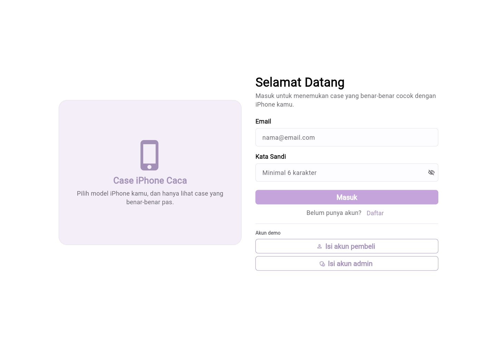
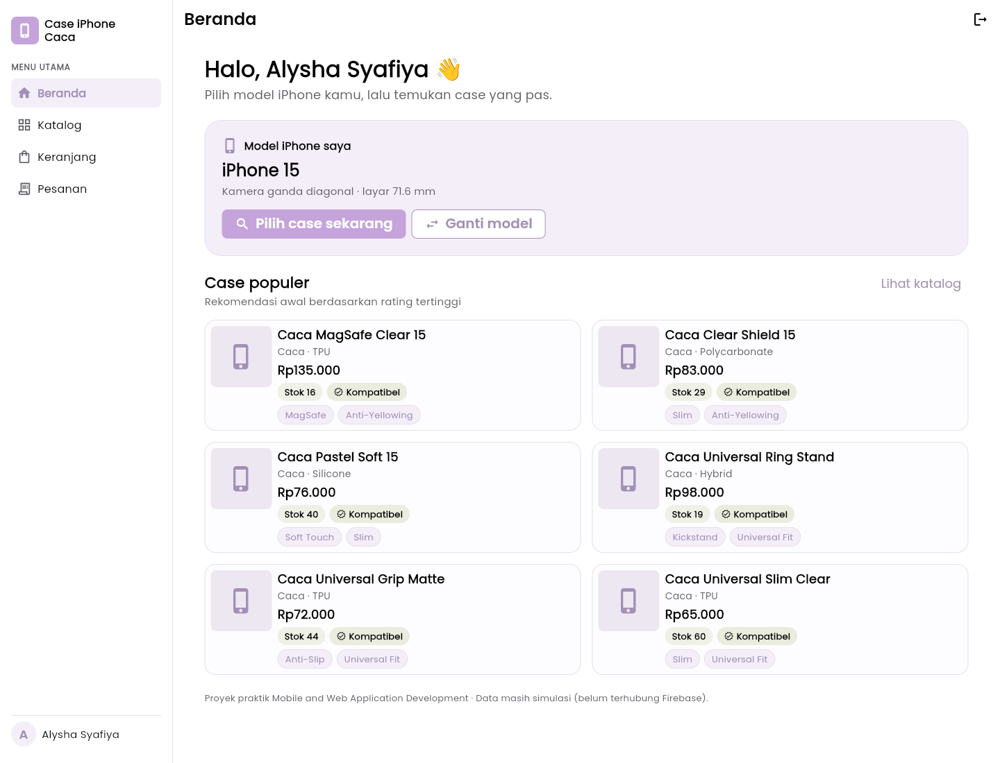
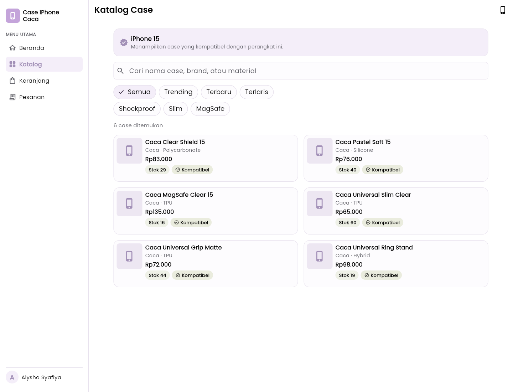
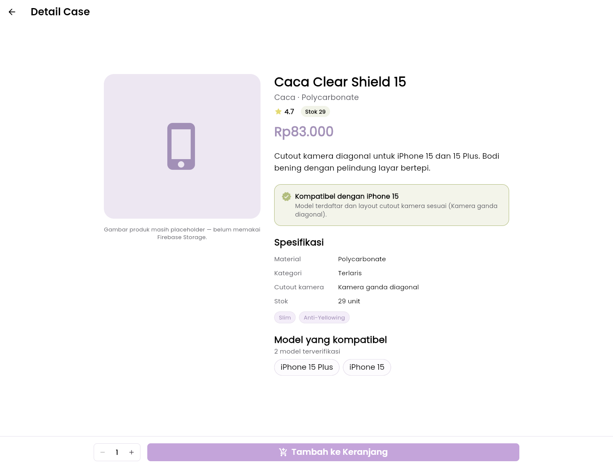
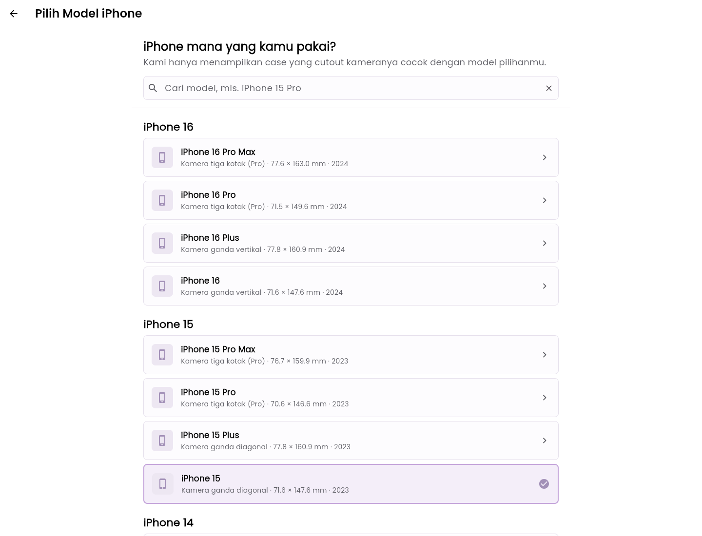
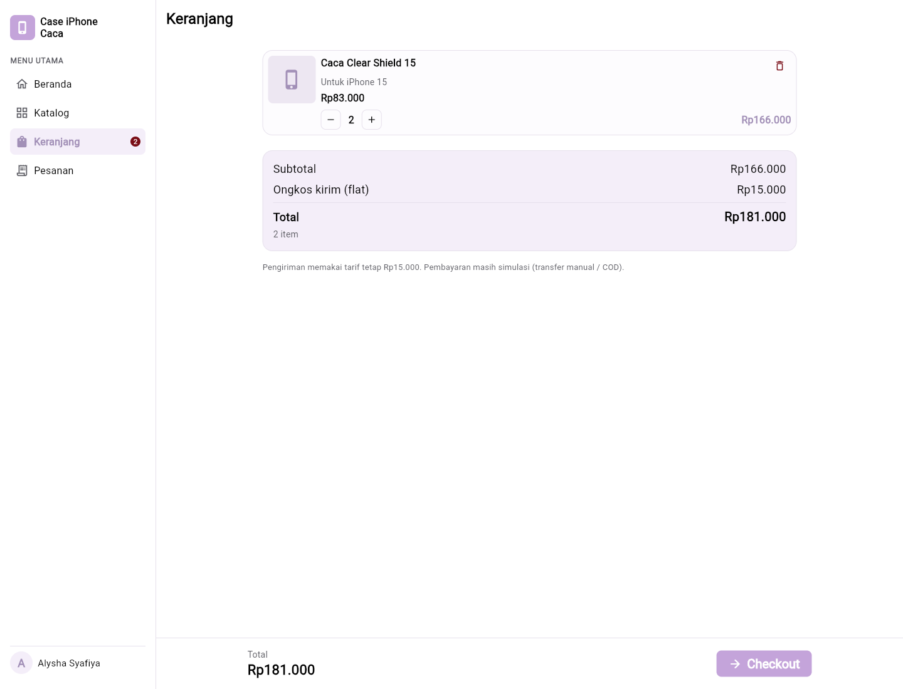
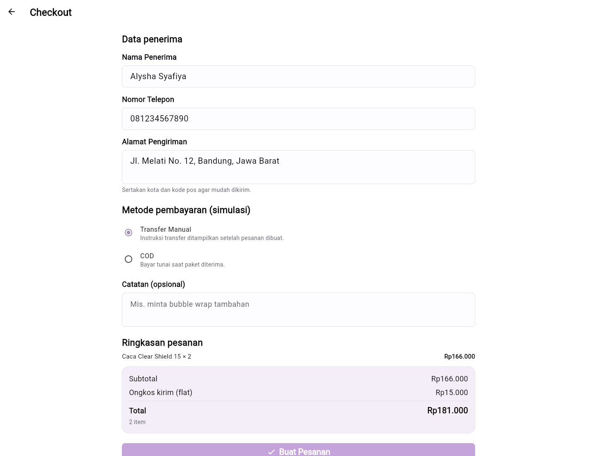
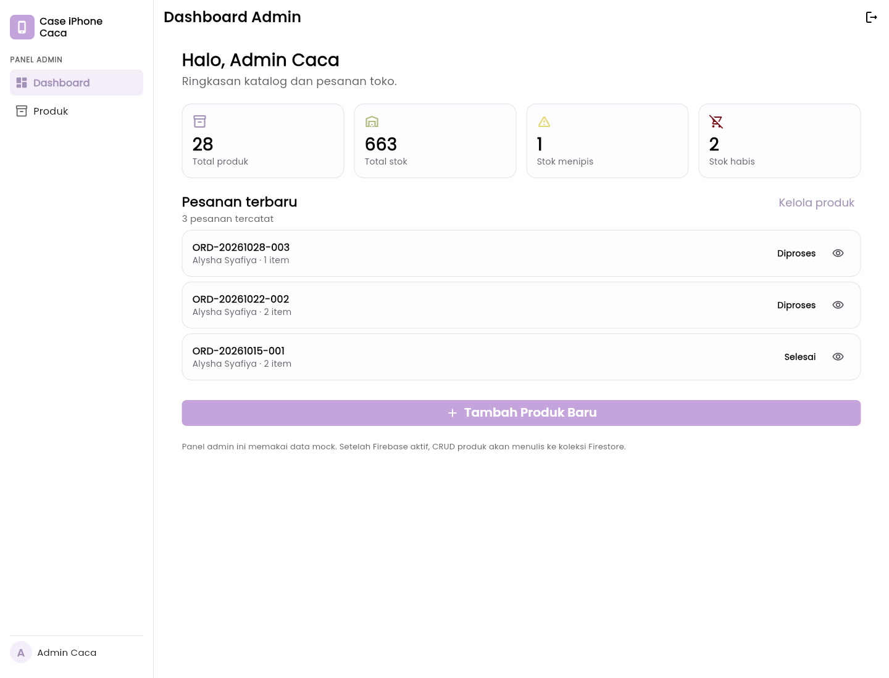
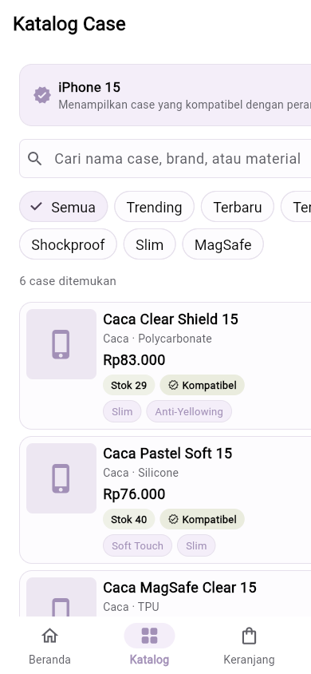
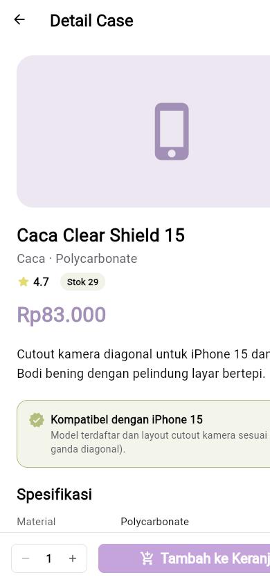

# CASE IPHONE CACA

**Aplikasi Katalog dan Pemilihan Case iPhone Berdasarkan Model iPhone**

> Repositori ini berisi **source code lengkap Flutter/Dart** (mobile **dan** web), proposal UTS, diagram perancangan, dan screenshot — bukan hanya README dan screenshot. Seluruh kode aplikasi ada di folder `lib/` dan dapat langsung dijalankan dengan `flutter run` atau `flutter run -d chrome`.

- Repository: https://github.com/cacaalycha/UTS-MOBILE-AND-WEB-APPLICATION-DEVELOPMENT
- Demo web (GitHub Pages): https://cacaalycha.github.io/UTS-MOBILE-AND-WEB-APPLICATION-DEVELOPMENT/

---

## 1. Identitas Project

| Keterangan | Informasi |
|---|---|
| Nama Project | Case iPhone Caca |
| Nama Mahasiswa | Alysha Syafiya Maisaroh |
| NIM | 23.01.55.0001 |
| Kelas | Pagi A1 |
| Mata Kuliah | Mobile and Web Application Development |
| Framework | Flutter (Dart) |
| Package name | `case_iphone_caca` |
| Versi | 1.0.0+1 |

## 2. Deskripsi Project

Case iPhone Caca merupakan aplikasi katalog penjualan case iPhone berbasis Flutter yang membantu pengguna menemukan case yang benar-benar cocok dengan model iPhone yang dimiliki. Permasalahan utama yang diselesaikan adalah **ketidakcocokan case dengan model iPhone** (terutama perbedaan cutout kamera dan ukuran bodi) yang sering menyebabkan salah beli.

Aplikasi menyediakan pemilihan model iPhone, katalog produk, detail produk, **Compatibility Checker** yang menyaring case berdasarkan model dan tipe cutout kamera, keranjang belanja, checkout dengan validasi form, riwayat pesanan, serta halaman admin untuk kelola produk. Pengguna utamanya adalah pemilik iPhone yang ingin membeli case secara online, dan admin toko sebagai pengelola katalog.

Pada versi UTS ini data masih berupa **mock data / mock repository** (tanpa backend). Rancangan database Firestore untuk pengembangan lanjutan tersedia di dalam proposal.

## 3. Isi Repositori (Source Code Lengkap)

| Folder / Berkas | Isi |
|---|---|
| `lib/main.dart`, `lib/app.dart` | Entry point dan root widget (MaterialApp + Provider) |
| `lib/models/` | 5 model: `UserModel`, `IphoneModel`, `CaseModel`, `CartItemModel`, `OrderModel` |
| `lib/data/mock/` | Data mock: 20 model iPhone, case, pesanan, akun demo |
| `lib/data/repositories/` | Abstraksi repository + 4 implementasi mock (auth, product, cart, order) |
| `lib/providers/` | State management `ChangeNotifier`: auth, product, cart, order |
| `lib/router/app_router.dart` | GoRouter + `StatefulShellRoute` + role guard (pembeli/admin) |
| `lib/pages/auth/` | Login & Register dengan validasi form |
| `lib/pages/home/`, `lib/pages/model/` | Beranda & Pemilihan Model iPhone |
| `lib/pages/catalog/` | Katalog (filter + pencarian) & Detail Case + Compatibility Checker |
| `lib/pages/cart/`, `lib/pages/order/` | Keranjang, Checkout, Konfirmasi, Pesanan Saya, Detail Pesanan |
| `lib/pages/admin/` | Dashboard Admin, Kelola Produk, Form Tambah/Edit Produk |
| `lib/widgets/` | Widget reusable: `AppShell`, `CaseCard`, buttons, badges, empty state, section header |
| `lib/core/` | Tema Material 3, warna, tipografi, spacing, validator |
| `test/` | 5 file widget/unit test (smoke test, detail, layout mobile, provider) |
| `android/`, `ios/`, `web/`, `windows/`, `linux/`, `macos/` | Konfigurasi platform bawaan Flutter (termasuk **Flutter Web**) |
| `pubspec.yaml`, `pubspec.lock`, `analysis_options.yaml`, `.metadata` | Dependensi dan konfigurasi project |
| `Proyek_UTS_Case_iPhone_Caca_Proposal.docx` / `.pdf` | Proposal UTS lengkap |
| `docs/` | Diagram user flow, sitemap, wireframe, skema Firestore |
| `screenshots/` | 10 screenshot aplikasi running |
| branch `gh-pages` | Hasil build statis `flutter build web --release` (versi web siap hosting) |

## 4. Fitur Aplikasi

### A. Fitur Pembeli
- **Login & Register** — autentikasi mock dengan validasi email dan password.
- **Beranda** — ringkasan produk dan akses cepat ke fitur utama.
- **Pilih Model iPhone** — 20 model dikelompokkan per seri; model tersimpan sebagai preferensi.
- **Katalog Produk** — daftar case dengan pencarian dan filter kategori.
- **Compatibility Checker** — case hanya tampil bila model iPhone terdaftar dan tipe cutout kamera cocok.
- **Detail Produk** — informasi case, harga, daftar model kompatibel.
- **Keranjang Belanja** — tambah/hapus item, ubah jumlah, total harga.
- **Checkout** — form nama, telepon, alamat dengan validasi (wajib diisi, format, minimal panjang).
- **Konfirmasi & Pesanan Saya** — status pesanan beserta detail.

### B. Fitur Admin
- Dashboard admin, manajemen produk (tambah, edit, hapus) dengan form tervalidasi.

### C. Prioritas Fitur
Urutan prioritas: (1) pemilihan model iPhone, (2) Compatibility Checker, (3) katalog & detail, (4) keranjang + checkout tervalidasi, (5) riwayat pesanan, (6) admin. Alur inti "pilih model → cari case yang cocok → pesan" diprioritaskan karena itulah yang langsung menyelesaikan masalah salah beli case.

## 5. Desain UI/UX dan Prototype Figma

- **Figma Design / Wireframe:** https://www.figma.com/design/TPBZUe0azGKFVuAyHcQ0nq/-23.01.55.0001--%E2%80%93--Case-iPhone-Caca--%E2%80%93-Wireframe?node-id=1-2&t=lGxr09H65HQXbOiX-1
- **Figma Prototype:** https://www.figma.com/proto/TPBZUe0azGKFVuAyHcQ0nq/-23.01.55.0001--%E2%80%93--Case-iPhone-Caca--%E2%80%93-Wireframe?node-id=7-22&p=f&t=3IUcGORs9VA7dQZJ-1&scaling=scale-down&content-scaling=fixed&page-id=1%3A3&starting-point-node-id=7%3A22
- Versi gambar lokal (tanpa perlu login Figma): `docs/wireframe.png`

Diagram perancangan lainnya:

| Diagram | Berkas |
|---|---|
| User flow | `docs/user-flow.png` |
| Sitemap | `docs/sitemap.png` |
| Wireframe low fidelity | `docs/wireframe.png` |
| Rancangan database Firestore | `docs/firestore-schema.png` |

## 6. Proposal UTS

- **PDF:** [`Proyek_UTS_Case_iPhone_Caca_Proposal.pdf`](Proyek_UTS_Case_iPhone_Caca_Proposal.pdf)
- **DOCX:** [`Proyek_UTS_Case_iPhone_Caca_Proposal.docx`](Proyek_UTS_Case_iPhone_Caca_Proposal.docx)

Berisi: problem statement, persona, user story, kebutuhan fungsional & non-fungsional, prioritas fitur, user flow, sitemap, wireframe, tech stack, rancangan database Firestore, rencana pengujian, dan roadmap pengembangan.

## 7. Teknologi yang Digunakan

| Teknologi | Kegunaan |
|---|---|
| Flutter 3.x / Dart 3 | Framework & bahasa (Material 3, responsif mobile & web) |
| Provider | State management (`ChangeNotifier`) |
| GoRouter | Navigasi, nested shell route, redirect & role guard |
| Google Fonts | Tipografi |
| Intl | Format mata uang / angka |
| Cupertino Icons | Ikon antarmuka |
| Flutter Web | Target web (`flutter run -d chrome`, `flutter build web`) |
| Figma | Perancangan UI/UX dan prototype |
| GitHub / GitHub Pages | Source code, riwayat commit, dan hosting demo web |
| Firebase Firestore | **Rancangan** database untuk tahap lanjutan (belum diintegrasikan) |

## 8. Cara Menjalankan Project

### Persyaratan
- Flutter SDK (Dart SDK termasuk di dalamnya)
- VS Code / Android Studio
- Emulator Android, perangkat fisik, atau Chrome untuk target web

### Langkah 1 — Clone / buka folder project

```bash
git clone https://github.com/cacaalycha/UTS-MOBILE-AND-WEB-APPLICATION-DEVELOPMENT.git
cd UTS-MOBILE-AND-WEB-APPLICATION-DEVELOPMENT
```

### Langkah 2 — Install dependencies

```bash
flutter pub get
```

### Langkah 3 — Cek konfigurasi (opsional)

```bash
flutter doctor
flutter analyze
```

### Langkah 4 — Jalankan aplikasi

```bash
# Mobile / desktop (pilih device yang tersedia)
flutter run

# Web di browser Chrome
flutter run -d chrome

# Atau build web statis lalu sajikan folder build/web
flutter build web --release
```

### Langkah 5 — Jalankan pengujian

```bash
flutter test
```

### Akun Demo

| Peran | Email | Password |
|---|---|---|
| Pembeli | `pembeli@caca.test` | `123456` |
| Admin | `admin@caca.test` | `123456` |

> Catatan: data masih mock (in-memory). Login, keranjang, dan pesanan akan kembali ke kondisi awal saat aplikasi di-restart.

## 9. Demo Web

Versi web aplikasi dapat dibuka langsung tanpa install Flutter melalui GitHub Pages:

**https://cacaalycha.github.io/UTS-MOBILE-AND-WEB-APPLICATION-DEVELOPMENT/**

Hasil build statisnya (`flutter build web --release`) disimpan terpisah di branch `gh-pages` agar branch `main` tetap berisi source code yang ringan. Untuk menjalankan versi web secara lokal, cukup `flutter run -d chrome` atau `flutter build web --release` dari source di branch `main`.

## 10. Rancangan Penyimpanan Data

Saat ini: mock repository di `lib/data/repositories/impl/` (data in-memory).

Tahap lanjutan: **Cloud Firestore** dengan koleksi `users`, `iphones`, `cases`, `carts`, dan `orders` (+ sub-koleksi `items`). Relasi, field, tipe data, contoh dokumen JSON, serta aturan keamanan dijelaskan di proposal dan `docs/firestore-schema.png`. Abstraksi repository sudah disiapkan sehingga implementasi Firestore dapat menggantikan mock tanpa mengubah UI.

## 11. Screenshot Aplikasi

### A. Halaman Login


### B. Halaman Beranda


### C. Halaman Katalog


### D. Halaman Detail Produk


### E. Halaman Pilih Model iPhone


### F. Halaman Keranjang


### G. Halaman Checkout (form tervalidasi)


### H. Halaman Admin


### I. Tampilan Mobile — Katalog & Detail



## 12. Riwayat Pengembangan

Riwayat commit disusun bertahap mengikuti proses pengerjaan, bukan satu commit besar: inisialisasi project → model & data → repository & state → widget & tema → autentikasi → katalog & compatibility → keranjang/checkout/pesanan → admin → pengujian → dokumentasi & proposal → build web.

---

**Case iPhone Caca**  
Developed by **Alysha Syafiya Maisaroh**  
NIM: 23.01.55.0001 — Kelas Pagi A1
